# Vulpen
<div align="center">

&nbsp;&nbsp;&nbsp;&nbsp;

&nbsp;&nbsp;&nbsp;&nbsp;

&nbsp;&nbsp;&nbsp;&nbsp;

</div>

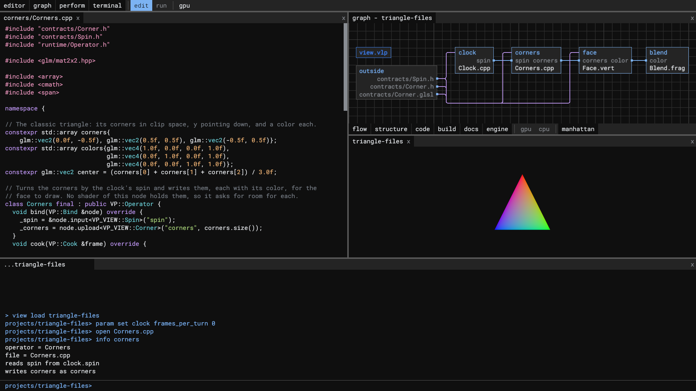

Vulpen is a fractal basis for anything that benefits from high performance computing or real-time visuals. C++ and GLSL are written side by side, without worrying about moving data from one to the other, and Vulpen attaches easily to existing projects for visual generation and parallel computation.

## The language: nodes and connections

A project is a view: one manifest, `view.vlp`, and a folder for each node. A node is a C++ class, shaders, or both, and a connection carries a GPU buffer, an image or a C++ object from one node's port to the others. The graph is the manifest as it runs.


*[`projects/triangle-files`](projects/triangle-files): every file a node. `clock` hands the turn to `corners` as a C++ object, `corners` writes the corners for the GPU, `face` places them and `blend` colors the pixels between them. What two nodes share is a contract in `contracts/`, a GLSL struct or a C++ header.*

- **C++ and GLSL meet by name.** A node's C++ asks for its shaders' values, buffers and images by the names the shaders give them, and the loader checks each against SPIR-V reflection before the first frame, so a mismatch fails at load, naming its cause.
- **Barriers come from the graph.** Each node declares what it reads and writes, and Vulpen places the Vulkan barriers between passes.
- **Data stays on the GPU** from node to node, until C++ reads it back.
- **A small manifest language.** A few words, each with a closed set of values; a bigger recipe of the library uses smaller ones and connects them, never copying their code.

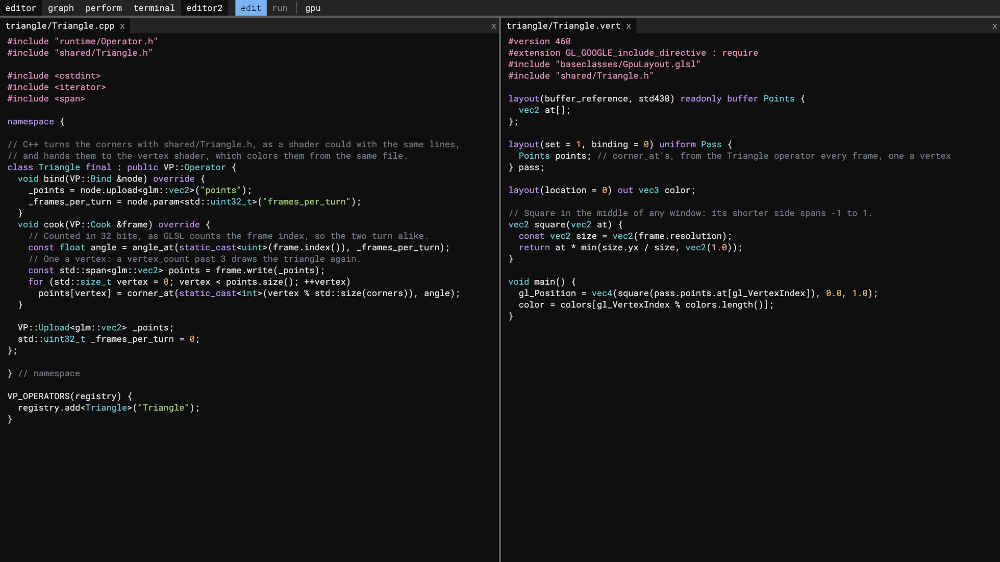
*[`projects/triangle-twin`](projects/triangle-twin): the operator in C++ and the vertex shader in GLSL both include `shared/Triangle.h`, which holds the triangle's corners, colors and turn once, in the words the two languages share.*

## The ide

`./run.sh --ide` opens the ide: an editor, the graph, the Perform panel with the project running in it, and a terminal, each a panel a drag of its tab moves. A press on a box opens its code in the editor, to change while the project runs; `f1` gives the project the whole window.


*Perform mode: the project presented in the whole window, as it would run on its own.*

## The graph

The graph shows a view's nodes and connections, a level at a time, or any folder `open` names, with what links its files, a layer each: flow, a connection; structure, a recipe a node uses; code, an include; build, a CMake file naming a file; docs, a document linking a file or a file citing an id the principles or requirements define; engine, what the engine carries from a node's C++ to its shaders. Zooming into a box goes inside it, and zooming out goes up a level. Here is Vulpen in its own graph, part by part:

<table>
<tr>
<td width="50%"><br /><sub>The repository</sub></td>
<td width="50%">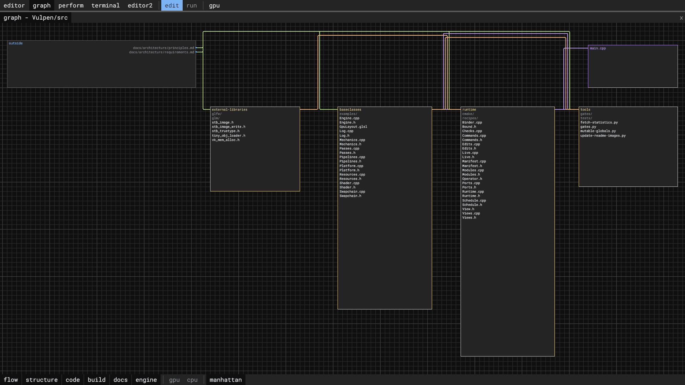<br /><sub><code>src/</code>: the baseclasses and the runtime, the libraries they build on, the tools and <code>main.cpp</code></sub></td>
</tr>
<tr>
<td>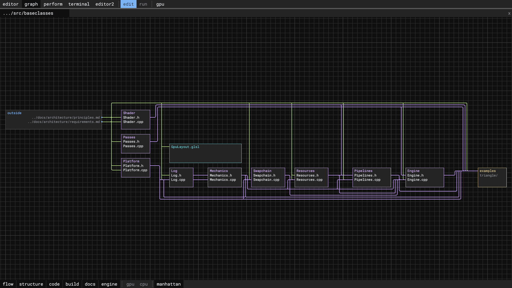<br /><sub><code>src/baseclasses/</code>: the GPU layer, a library of its own</sub></td>
<td>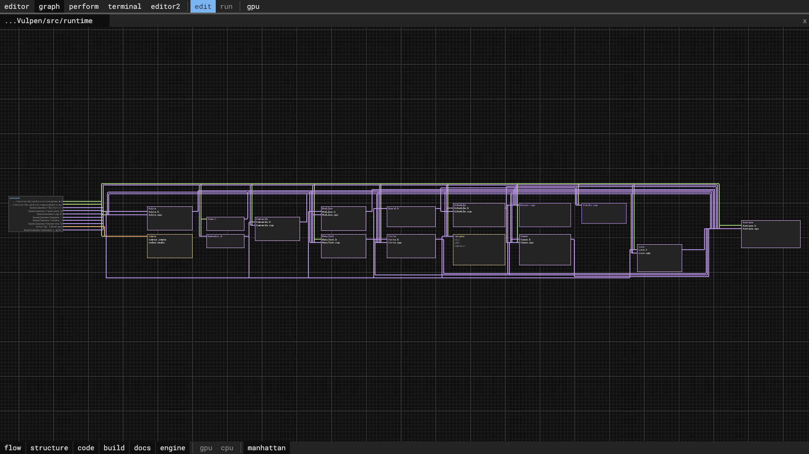<br /><sub><code>src/runtime/</code>: the manifest, the views, the commands, the ports and live code, and the recipes</sub></td>
</tr>
<tr>
<td>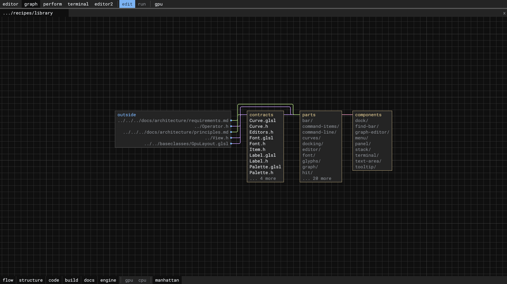<br /><sub>The library: contracts, parts and components</sub></td>
<td>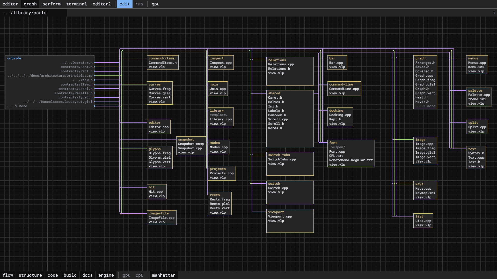<br /><sub>The parts, each one job's code</sub></td>
</tr>
<tr>
<td>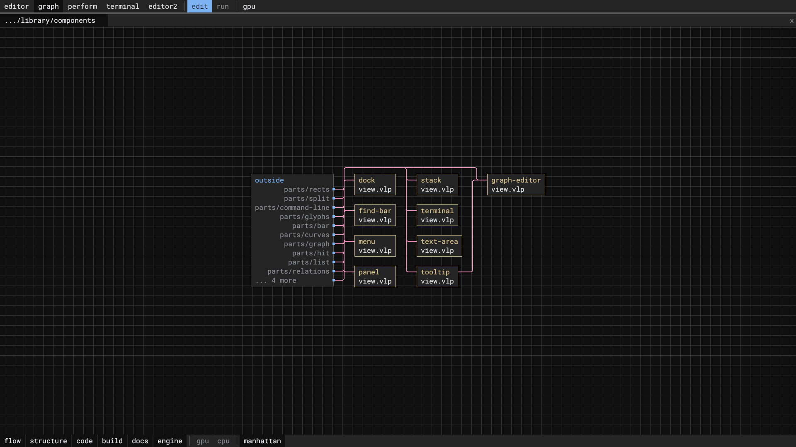<br /><sub>The components, parts used together</sub></td>
<td>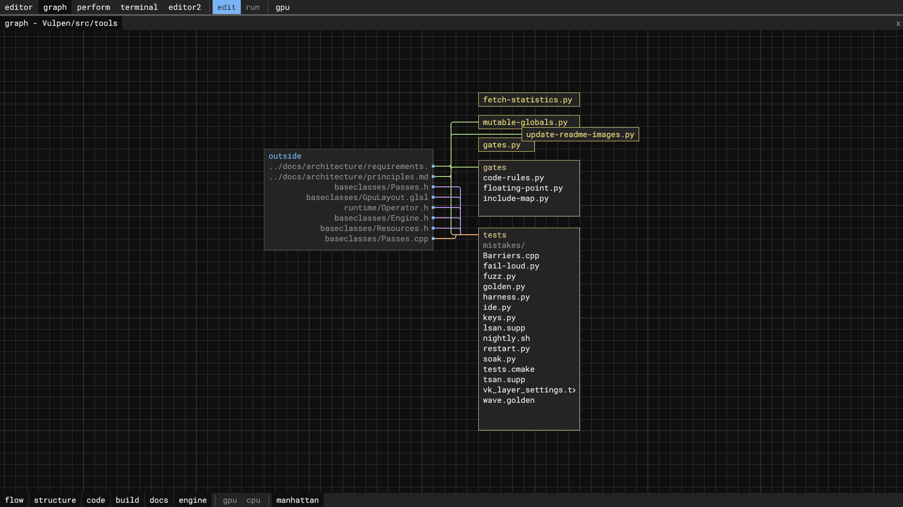<br /><sub><code>src/tools/</code>: the gates, the statistics, these pictures and the tests</sub></td>
</tr>
<tr>
<td>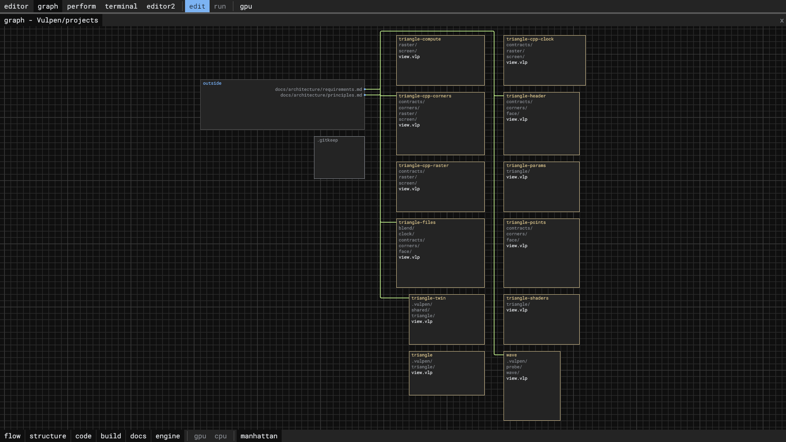<br /><sub>The example projects</sub></td>
<td>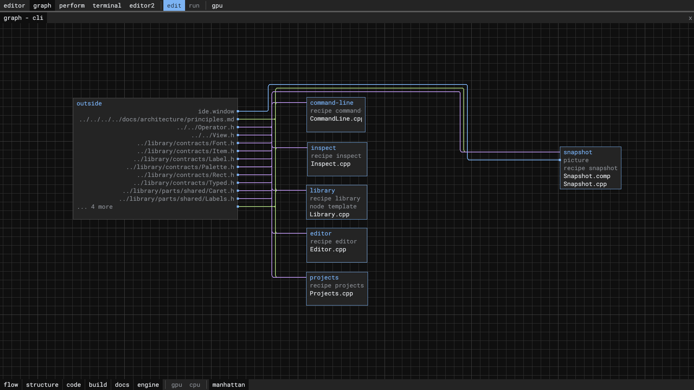<br /><sub>The cli's nodes, with the snapshot the picture script adds by a command</sub></td>
</tr>
</table>

The ide is a view too, made of the library's recipes as any project is, panels, splits, a text area, the graph and a terminal, so it shows in its own graph, and Vulpen is edited with Vulpen.


*The ide inside its own graph: each box a recipe of the library, each wire a connection.*

## The cli

`./run.sh --cli` runs the same command line at a terminal, with no window. Every action is a command with a text form, the ide's presses and drags included, so anything it does can be typed, run from a file with `--source`, or saved with `log save` and replayed to rebuild the same graph. Everything runs headless: batch compute, tests, scripts and agents need no display.


*`help` lists every command and what it does; `ls` shows a view as folders, and `info` a node's files, params and connections.*

## Run

```bash
./run.sh [--release] [--cli | --ide | --<project> | view.vlp] [arguments]     # Linux
.\run.ps1 [--release] [--cli | --ide | --<project> | view.vlp] [arguments]    # Windows
```

Configures, builds and runs the `debug` preset, or `release` with `--release`; the binary lands in `out/build/<preset>/`. `--cli` runs the cli alone, a prompt at the terminal; `--ide` runs the cli hosting the ide, a window; `--<project>` runs a project alone, of those the cli makes in `projects/`, as the example projects `wave` and `triangle`; and with no view named the scripts run the one their line `default=--ide` names.

`--log error|warn|info|debug` sets how much the run says, the build included. The default, `warn`, prints only problems, and of a build that succeeds only its newest line, in place while it builds and gone once it is done; `debug` prints the build's output too. [`src/baseclasses/Log.h`](src/baseclasses/Log.h) lists what each level adds and what each `{tag}` marks, and a node's `log` word in the manifest sets the level of the lines about that node. Each run keeps what it printed in `docs/logs/`, which git ignores, the newest 20 runs, so a run on another machine leaves behind what went wrong, a failed build's output included.

`./run.sh --wave --log info` runs the example project `wave` headless; `./run.sh --triangle` opens a window and draws the classic triangle, whose corners and colors come from C++, and `out/build/debug/baseclasses/examples/triangle/triangle` draws one with the baseclasses alone, without the runtime. In the `debug` preset, save any C++ or GLSL of a view while it runs and the running view swaps in the change.

## Test

```bash
ctest --preset debug                 # after a build; also release, asan, tsan, gpu-validation
src/tools/tests/nightly.sh           # every preset, the soaks and the long fuzz
```

<sub>Every release build takes the pictures above anew: [`src/tools/update-readme-images.py`](src/tools/update-readme-images.py) replays the commands that make each, and the [`snapshot`](src/runtime/recipes/library/parts/snapshot) part saves the ide's window, with no window open.</sub>
