<h1 align="center">Vulpen</h1>

<p align="center">
  <b>Write C++ and GLSL side by side. Wire them as a graph. Change them while they run.</b><br />
  A Vulkan engine for real-time visuals and GPU compute, whose programs are nodes and connections.
</p>

<p align="center">
  
  &nbsp;&nbsp;&nbsp;
  
  &nbsp;&nbsp;&nbsp;
  
  &nbsp;&nbsp;&nbsp;
  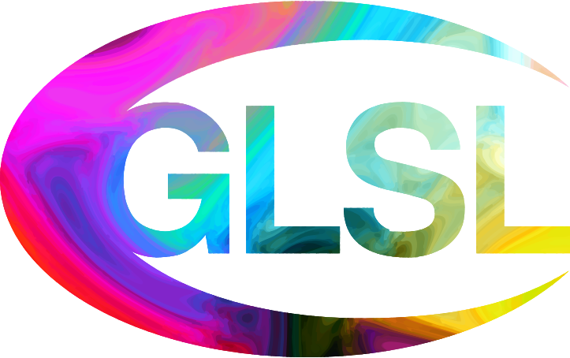
</p>

<p align="center">
  <a href="#quick-start">Quick start</a> ·
  <a href="#what-you-get">What you get</a> ·
  <a href="#the-language">The language</a> ·
  <a href="#the-ide">The ide</a> ·
  <a href="#the-cli">The cli</a> ·
  <a href="#build-and-test">Build and test</a> ·
  <a href="#license">License</a>
</p>

<p align="center"><sub>
  Early: commands and manifest words still change between versions. Tested on Linux and Windows; macOS is untested.
</sub></p>

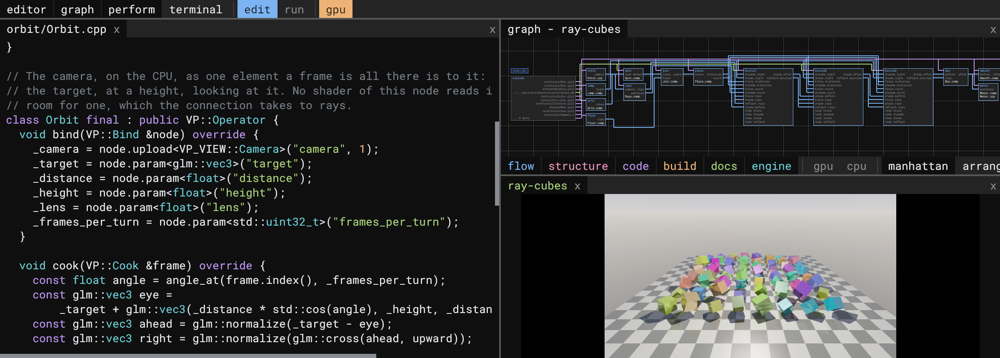

## What you get

<table>
<tr>
<td width="33%" valign="top">
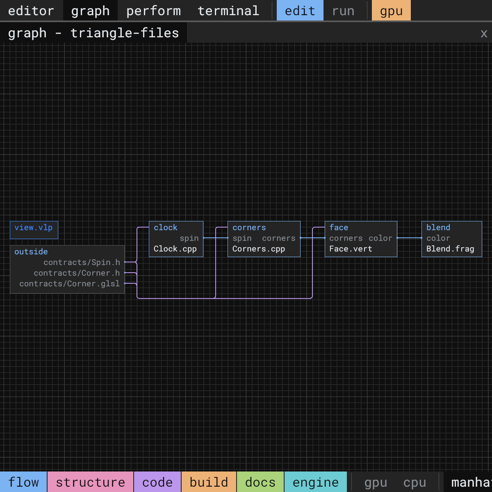<br />
<b>Programs are graphs.</b> A small manifest names the nodes and the connections between them. The graph is that manifest as it runs, and Vulpen places every Vulkan barrier from it.
</td>
<td width="33%" valign="top">
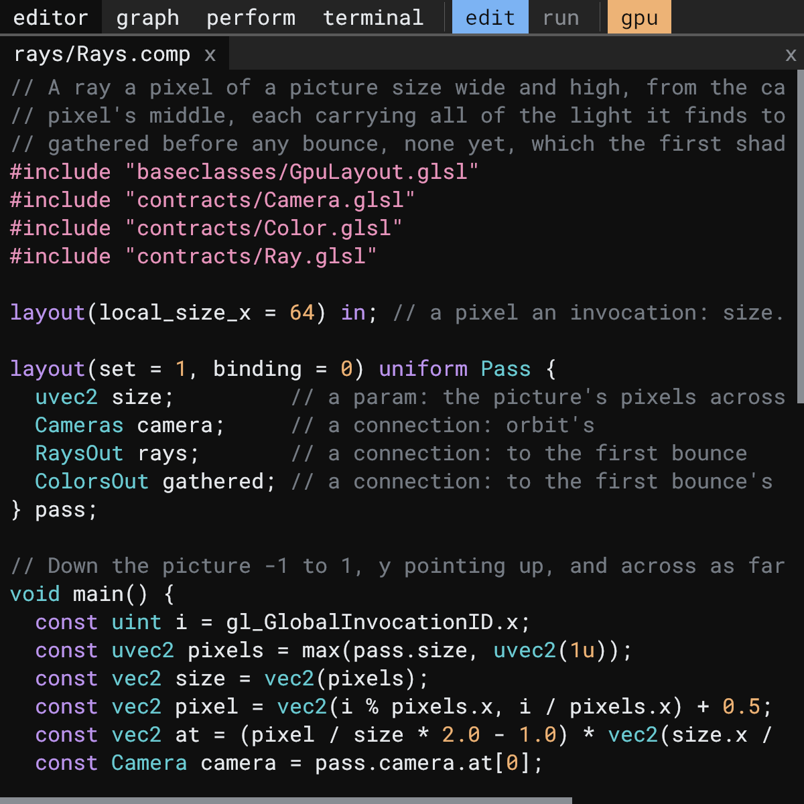<br />
<b>C++ and GLSL meet by name.</b> A node's C++ asks for its shaders' values, buffers and images by the names the shaders give them, checked against SPIR-V reflection before the first frame.
</td>
<td width="33%" valign="top">
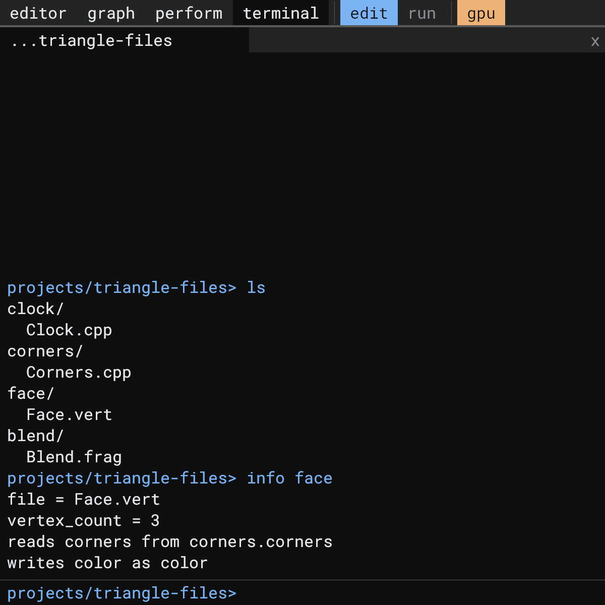<br />
<b>Every action is a command.</b> The ide's presses and drags included: anything it does can be typed, scripted with <code>--source</code>, or replayed from a log, with no window at all.
</td>
</tr>
</table>

## Quick start

On Linux:

```bash
git clone https://github.com/CorrelateVisuals/Vulpen-GPU.git Vulpen
cd Vulpen
./run.sh                 # builds the debug preset and opens the ide
```

On Windows, in PowerShell:

```powershell
git clone https://github.com/CorrelateVisuals/Vulpen-GPU.git Vulpen
cd Vulpen
.\run.ps1                # builds the debug preset and opens the ide
```

In the ide's terminal, type `view load life`, then double-click a file in the graph to open it. Save a C++ or GLSL file while it runs and the running project swaps the change in. <kbd>F1</kbd> gives the project the whole window.

> [!NOTE]
> Vulpen needs a GPU and driver with Vulkan 1.2, descriptor indexing and buffer device address.

<details>
<summary><b>Prerequisites</b></summary>

On every system: CMake 3.24 or newer, Python 3, and the Vulkan headers and loader with `glslangValidator` and `spirv-val`, as the [LunarG Vulkan SDK](https://vulkan.lunarg.com/) installs them.

**Linux:** GCC 13 or newer, or Clang with a standard library that has `std::format`, and the X11 and Wayland headers the bundled GLFW builds against. On Ubuntu 24.04 and Debian 13 or newer, the distribution's packages hold all of it:

```bash
sudo apt install build-essential cmake python3 libvulkan-dev glslang-tools spirv-tools \
                 libwayland-dev libxkbcommon-dev xorg-dev
```

Older releases, such as Ubuntu 22.04 and Debian 12, need a newer GCC beside their own (Ubuntu 22.04 a newer CMake too), named when a build folder is first configured: `CC=gcc-14 CXX=g++-14 ./run.sh`.

**Windows:** Visual Studio 2022, or its Build Tools, with the C++ workload, and the LunarG Vulkan SDK; CMake and Python on the `PATH`. If PowerShell refuses to run `run.ps1`, allow local scripts once with `Set-ExecutionPolicy -Scope CurrentUser RemoteSigned`.

GLFW, GLM, stb, tinyobjloader and the Vulkan Memory Allocator come with the repository, pinned in [`src/external-libraries/`](src/external-libraries) ([licenses](docs/licenses/README.md)).

</details>

## The language

A project is a view: one manifest, `view.vlp`, and a folder for each node. A node is a C++ class, shaders, or both, and a connection carries a GPU buffer, an image or a C++ object from one node's port to the others.

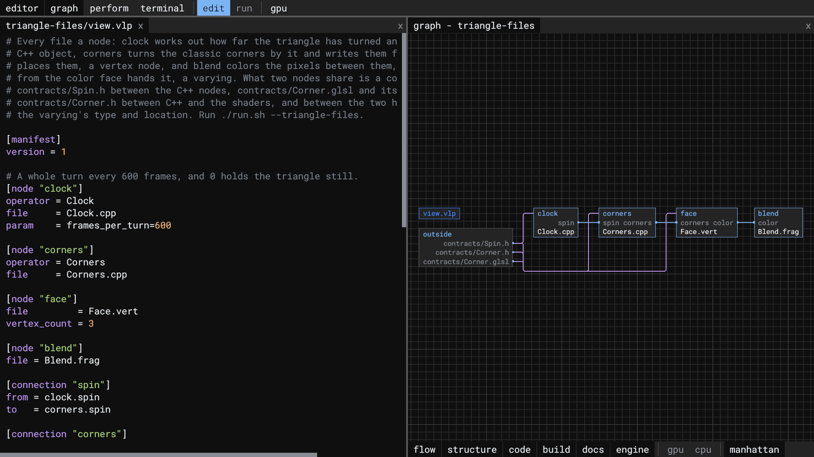

- **Barriers come from the graph.** Each node declares what it reads and writes, and Vulpen places the Vulkan barriers between passes.
- **Data stays on the GPU** from node to node, until C++ reads it back.
- **Contracts, not copies.** What two nodes share is a contract in `contracts/`: a GLSL struct, or a C++ header both languages read.
- **A small, closed manifest language.** A few words, each with a closed set of values; a bigger recipe of the library uses smaller ones and connects them, never copying their code.

The graph opens any folder the same way. Here is Vulpen in its own graph, from the repository's top down to the part that draws the graph:

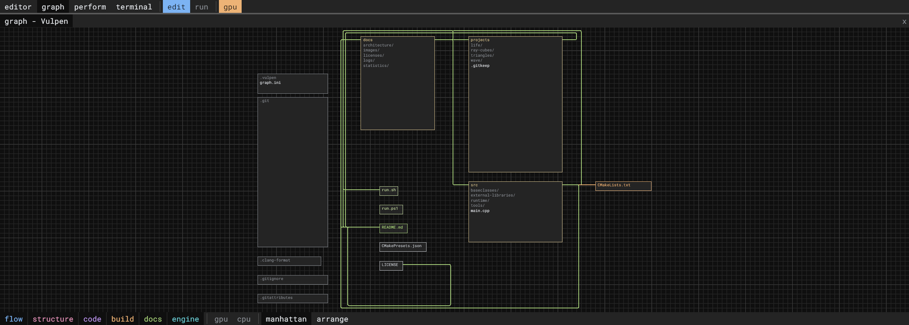
*Animated, a level every two seconds: the repository, `src/`, the runtime, the recipes, the library, its parts and the part that draws the graph, then the ide inside its own graph.*

## The ide

`./run.sh`, or `.\run.ps1` on Windows, opens the ide: an editor, the graph, the Perform panel with the project running in it, and a terminal. Each is a panel that a drag of its tab moves. Double-click a file in the graph to open it, and change it while the project runs.

<details>
<summary><b>Perform mode, the graph of a whole repository, and the ide inside its own graph</b></summary>

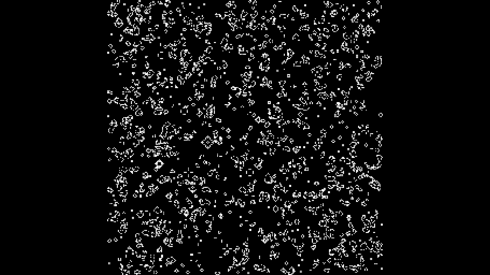
*Perform mode, <kbd>F1</kbd>: the project in the whole window, as it would run on its own.*

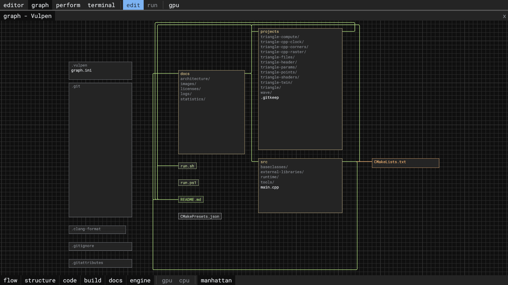
*`open ./` shows any folder in the graph, with what links its files, a layer each: flow, structure, code, build, docs and engine.*

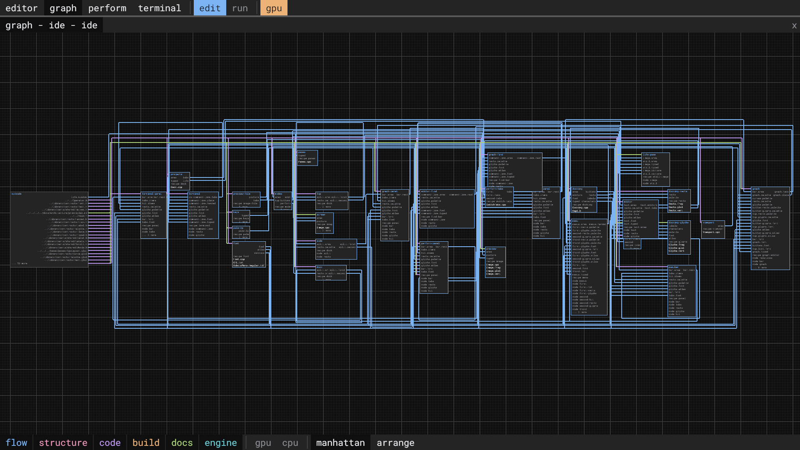
*The ide is a view too, made of the library's recipes, so Vulpen is edited with Vulpen.*

</details>

## The cli

`./run.sh --cli`, or `.\run.ps1 --cli`, runs the same command line at a terminal, with no window. Batch compute, tests, scripts and agents need no display, and a session saved with `log save` replays to the same graph.

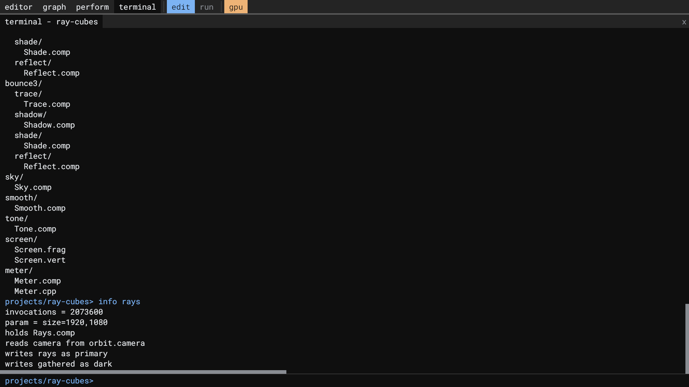

## Build and test

| Linux | Windows | What it does |
| --- | --- | --- |
| `./run.sh` | `.\run.ps1` | builds and runs the cli hosting the ide (`--ide`, the default) |
| `./run.sh --cli` | `.\run.ps1 --cli` | the command line alone, at the terminal |
| `./run.sh --triangle` | `.\run.ps1 --triangle` | one project of [`projects/`](projects) alone, in its own window |
| `./run.sh --life` | `.\run.ps1 --life` | Conway's Game of Life, its cells stepped on the GPU; `engine seed` sows them anew |
| `./run.sh --wave --log info` | `.\run.ps1 --wave --log info` | headless compute: `wave` fills a buffer and `probe` prints it |
| `./run.sh --release …` | `.\run.ps1 --release …` | the `release` preset, in place of `debug` |
| `cmake --build --preset debug` | `cmake --build --preset debug` | builds everything the tests run, where `./run.sh` builds vulpen and the projects it opens |
| `ctest --preset debug` | `ctest --preset debug` | the tests, after that build; also `release` and `gpu-validation` (on a GPU, as lavapipe cannot run it), and on Linux `asan` and `tsan` |
| `src/tools/tests/nightly.sh` | | every preset, the soak runs and the long fuzz |

`--log error|warn|info|debug` sets how much a run says; each run keeps its log in `docs/logs/`, the newest 20.

## Documentation

[Principles](docs/architecture/principles.md) and [requirements](docs/architecture/requirements.md) decide every design; the [include map](docs/architecture/include-map.md) is the engine on one page. [Statistics](docs/statistics) keep the line counts, start-up times and soak results.

## License

Vulpen is licensed under the [Mozilla Public License 2.0](LICENSE): use it in any project, open or closed source, and when you distribute changes to Vulpen's own files, share those files under the same license. The libraries in [`src/external-libraries/`](src/external-libraries) keep their own licenses, listed in [`docs/licenses/`](docs/licenses/README.md). The Vulkan, C++ and CMake logos above are [Simple Icons](https://simpleicons.org/) drawings, CC0 1.0; the GLSL logo is [GLSL Logo (Unofficial)](https://commons.wikimedia.org/wiki/File:GLSL_Logo_(Unofficial).svg) by Jim McKeeth, [CC BY-SA 4.0](https://creativecommons.org/licenses/by-sa/4.0/), unchanged. Vulkan and the Vulkan logo are registered trademarks of the Khronos Group Inc.

<sub>Every release build takes these pictures anew: [`src/tools/update-readme-images.py`](src/tools/update-readme-images.py) replays the commands that make each, and the [`snapshot`](src/runtime/recipes/vulpen/library/parts/snapshot) part saves the ide's window, with no window open.</sub>
